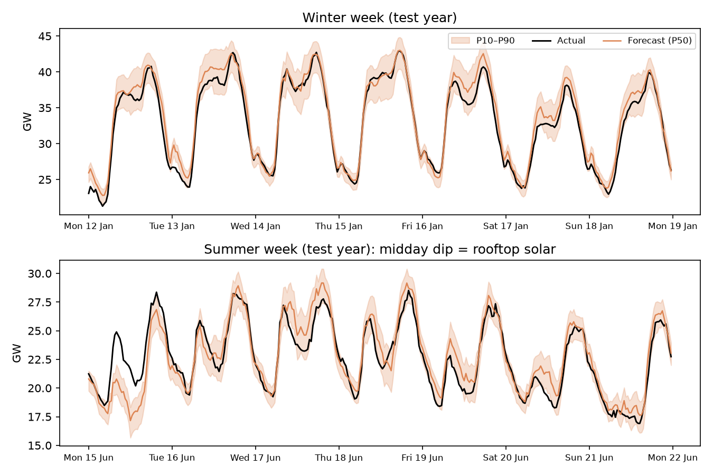
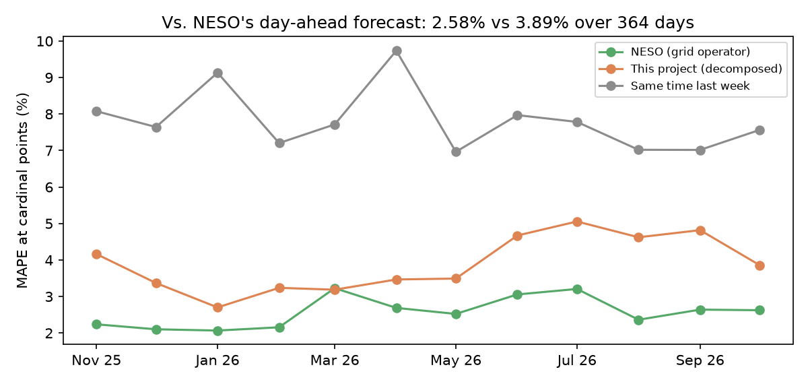
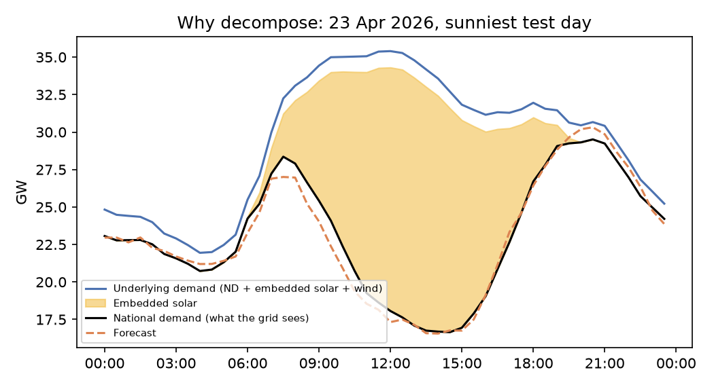
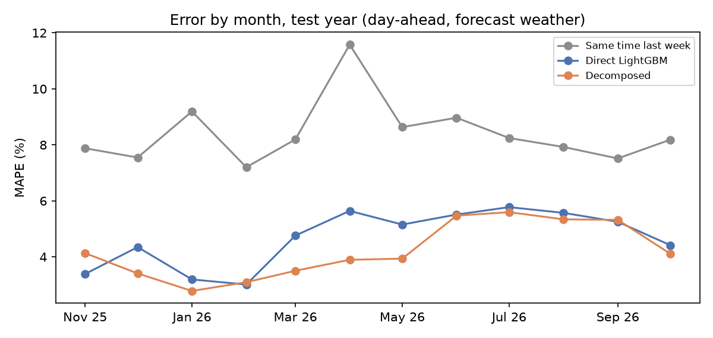

# Day-ahead electricity demand forecasting for Great Britain

Forecasts every half-hour of tomorrow's national electricity demand in Great Britain, with an 80% prediction interval
(P10–P90). It uses only free, public data and checks itself against the grid operator's own published forecast.

Trained models: [nipuna02/gb-demand-forecast-decomposed](https://huggingface.co/nipuna02/gb-demand-forecast-decomposed) on Hugging Face.



## Results

Test year: **1 Nov 2025 – 31 Oct 2026** (17,512 half-hours), never used for training or tuning. Every forecast uses
only what was known at about 08:00 the day before, including a **real weather forecast** issued the day before, not
the weather that actually happened.

| Model | MAPE [95% CI] | MAE | vs. week-ago (MASE) | P10–P90 coverage (target 80%) |
|---|---|---|---|---|
| Same half-hour last week | 8.43% [7.90, 8.93] | 2,139 MW | 1.00 | – |
| Direct LightGBM (quantile) | 4.68% [4.44, 4.93] | 1,125 MW | 0.53 | 55% |
| **Decomposed (this project)** | **4.22%** [4.00, 4.47] | **1,025 MW** | **0.48** | **75%** |
| Decomposed, given the *actual* weather (upper bound, not a real forecast) | 3.28% | | | |

**Against NESO, Great Britain's grid operator**, at the 4,115 "cardinal points" (daily peaks, troughs and fixed
times) where NESO publishes its day-ahead forecast:

| | MAPE at cardinal points |
|---|---|
| **NESO day-ahead forecast** | **2.58%** |
| This project (decomposed) | 3.89% |
| Same time last week | 7.83% |

NESO is better by **1.3 points** [1.1, 1.5] (paired day-block bootstrap). This project beats NESO at 36% of individual
points. NESO uses information this project doesn't have: metered data from the morning of the day before, commercial
weather feeds, and a team of forecasters. This project closes 75% of the gap between a naive forecast and NESO's,
using free data on a laptop.



## The idea: forecast what people use, not what the grid sees

National demand (ND) is what the transmission grid supplies. Millions of rooftop solar panels and small wind farms
connected *below* the grid hide part of real consumption. On a sunny spring day, national demand drops by more than
15 GW at midday, and that hidden capacity doubled from 13 GW to 25 GW between 2018 and 2026.



A single model trained on national demand struggles, because the solar effect keeps growing beyond anything in its
training years, and tree models can't extrapolate. So the forecast is split into three parts:

```
national demand = underlying demand  −  solar load factor × solar capacity  −  wind load factor × wind capacity
                  (LightGBM, L1)        (LightGBM on weather   (known, as of D-2)  (LightGBM on weather)
                                         at solar sites)
```

- **Underlying demand** (ND + NESO's estimates of embedded solar and wind) is smooth, heating-driven, and has no
  growing solar hole in it.
- **Load factors** (output per MW installed) are stable from year to year, so growth in capacity becomes a
  multiplication instead of an extrapolation.
- **Weather where the panels and turbines are:** solar uses six sites in southern England, wind uses six in
  Scotland, northern England and Cornwall, and demand uses five large cities weighted by population.

On validation, this took MAPE from 4.60% (direct) to 3.49%. Adding the solar and wind sites alone was worth about
0.5 points.

**Prediction intervals:** the direct model's quantile regressions were badly over-confident (55% coverage instead of
80%), because they were trained on actual weather but run on forecasts. The decomposed model instead uses
split-conformal intervals: the 10th and 90th percentiles of its relative errors on the validation year, separately
for each 4-hour block of the day. They give 75% coverage on the test year, close to the 80% target but still
slightly narrow.



## What's still hard

- **Summer midday** is the worst time: 5.3–5.6% MAPE in June–September overall, and 8.8% for the midday
  half-hours (10:00–16:00) in those months, against 2.8% in January. Solar output depends on cloud, which is hard to
  forecast a day ahead. With the actual weather the same model drops from 4.22% to 3.28%, so about a fifth of the
  error is the weather forecast's.
- **Embedded wind** forecast error is about 580 MW on average. Twelve weather points are a coarse picture of
  thousands of small wind and solar sites.
- **The worst days** (10–14% MAPE) are mostly summer days where the cloud forecast missed, plus Easter Sunday
  (5 Apr 2026). Easter Sunday isn't a bank holiday, so the model doesn't know the day is unusual. Christmas Day
  (11%) is also on the list.

## Data

| Source | What | Licence |
|---|---|---|
| [NESO historic demand data](https://www.neso.energy/data-portal/historic-demand-data) | Half-hourly ND, embedded solar/wind estimates and capacities, 2018–2026 | NESO Open Data Licence |
| [NESO day-ahead demand forecast archive](https://www.neso.energy/data-portal/1-day-ahead-demand-forecast) | NESO's published day-ahead forecasts at cardinal points | NESO Open Data Licence |
| [Open-Meteo historical weather](https://open-meteo.com/en/docs/historical-weather-api) | Actual hourly weather (ERA5) for training | CC BY 4.0 |
| [Open-Meteo previous model runs](https://open-meteo.com/en/docs/previous-runs-api) | Weather forecasts issued one day before, for validation and test | CC BY 4.0 |

Split: train 15 Jan 2018 – 31 Oct 2024 (actual weather), validation Nov 2024 – Oct 2025, test Nov 2025 – Oct 2026
(both with day-ahead weather forecasts). The chosen models are refitted on train + validation before the test year.

**Why not Sri Lanka?** I looked first. The Ceylon Electricity Board and PUCSL publish daily generation reports only
as PDFs with changing layouts and gaps, with no half-hourly or machine-readable series. Great Britain was the best
open alternative, and the method transfers to any grid with demand and weather data.

## Limitations

- **Embedded generation is estimated, not metered.** "Underlying demand" relies on NESO's own estimates of embedded
  solar and wind, so errors in those estimates flow into the target.
- **Information cut-off is approximate.** Lags use demand up to the end of day D-2 plus D-1 before 07:00. Capacity
  values are as of D-2. NESO's forecast is issued around 08:40 UTC with more information.
- **Cardinal-point matching is approximate.** NESO's windows are given in local clock time, and I map them to
  half-hours the same way every day, so on the two clock-change days a point can be off by one half-hour.
- **The neural network was dropped.** I planned a small MLP alongside LightGBM, but on a shared laptop CPU it was
  slow and the big gains turned out to come from the decomposition, not the model class. It isn't in the results.

## Reproduce

```bash
git clone https://github.com/Nipuna-Lakruwan/energy-demand-forecast.git
cd energy-demand-forecast
uv sync
uv run python scripts/download.py   # NESO + Open-Meteo, ~70 MB, no API keys
uv run python scripts/train.py      # validation, refit, test year, NESO comparison (~6 min on an M1)
uv run python scripts/figures.py
uv run pytest
```

Code: `data.py` (loading, time zones, weather aggregation), `features.py` (what's known at issue time),
`models.py` (direct quantile and decomposed models, conformal intervals), `neso.py` (cardinal-point comparison),
`metrics.py`. Every number above is in `results/metrics.json`.
